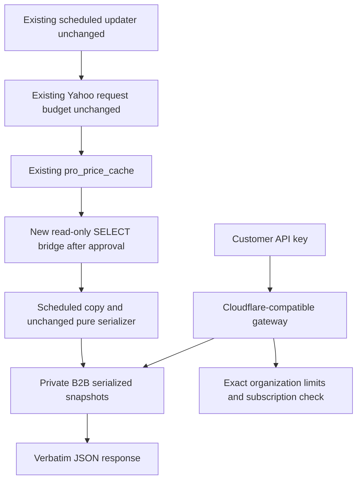

# SpyConverter B2B API architecture

This implementation is additive on `codex/b2b-api-platform`. All 283 original tracked files remain byte-for-byte unchanged. The new Cloudflare API gateway, private Supabase B2B schema/functions, live Stripe products, portal and webhook have been deployed under user authorization. Commercial checkout and live delivery remain disabled pending the remaining activation prerequisites. See RUNBOOK.md and REVIEW.md for current status; existing upstream schedules are unchanged.

## Existing services and routing

| Service | Repository evidence | B2B treatment |
| --- | --- | --- |
| Main website | Static HTML, root `styles.css`, existing logo; `_config.yml` documents GitHub Pages from main/root | Five directory-index pages under `/B2B/api/`; reuse native assets and scoped new CSS |
| News | Separate `news-app` Next.js/Vercel application | Untouched |
| Trading Journal | Separate `trading-journal` Vercel application | Untouched |
| Identity | Existing Supabase browser authentication in `docs/auth.js` | Production frontend reuses its session; gateway independently validates `/auth/v1/user` |
| SpyConverter Pro | Existing `profiles.is_subscribed`, Pro quotas and Stripe handling | No B2B access to these entitlements; separate schema, customers, prices and metadata |
| Market cache | Existing `public.pro_price_cache`, scheduled `refresh-pro-prices` function | Restricted SELECT-only bridge deployed; copy disabled; updater unchanged |
| Domain | Read-only DNS/HTTP audit showed Cloudflare proxying | Separate api hostname and Pages gateway created; existing DNS and security rules unchanged |

Directory indexes fit the existing static hosting layout without a framework migration or root rewrite. `/B2B/api` may receive the host's normal trailing-slash redirect to `/B2B/api/`; all navigation stays within this namespace. The older request for `/api/dashboard` is superseded by the explicit `/B2B/api/` isolation requirement. No old navigation links were edited. Server code, tests and evidence are under directories already excluded from Pages; new Markdown documentation matches its existing exclusions.

Authenticated console review confirmed GitHub Pages for the existing website and Cloudflare proxying. The separate API hostname has verified public DNS/TLS and returns JSON to cURL and Python clients. The five B2B directory indexes preserve existing website routing.

## The source of truth

The unchanged `contact-for-licencing/index.ts` calls the existing Pro request handler. That handler validates a Supabase identity and calls the existing access-snapshot RPC. It does **not** fetch Yahoo prices per customer GET. It reads a single cached quotes/timestamp record and uses the pure `priceResponse` serializer. Calling the original HTTP endpoint can involve the existing Pro authorization/quota path, so B2B never polls or proxies it.

The existing `refresh-pro-prices` implementation uses `yahoo-finance2`, admits one quote batch on the existing minute schedule, and bounds actual Yahoo HTTP requests, including session/crumb traffic. A separate legacy Python yfinance dependency also exists. Neither implementation, the refresh claim, nor any schedule has been changed. Unavailable backend source for other services cannot be audited beyond what is in this checkout.

## Exact JSON contract

| Existing field | Preserved contents |
| --- | --- |
| `Prices` | SPX, SPY, ES, NQ, QQQ, NDX, RUT, IWM, RTY, DJI, DIA, YM; number or null |
| Five ratio fields | `SPX/SPY Ratio`, `ES/SPY Ratio`, `NQ/QQQ Ratio`, `NDX/QQQ Ratio`, `ES/SPX Ratio`; number or null |
| Source and selection fields | `Datetime`, `ESSelection`, `ESContract`, `ESSymbol` |
| `ESQuote` | Existing name, timestamp, expiresAt and delayMinutes values and types |
| `ESContracts` | Existing array of contract, symbol and label objects |

`mirror.ts` imports the original snapshot parser and response serializer, then stores the serialized body as **text**, not JSONB. `/v1/conversions` returns that body verbatim, without a wrapper, additional fields, rounding or reserialization. Each supported `esContract` selection is materialized together. Source-dependent unavailable selections keep the original serializer's behavior. Byte-equivalence tests run both original and new request handlers against the same synthetic source snapshot and evaluation time, including missing-price/null cases.

`/v1/convert` is a separate optional calculation response, using the original instrument groups and cached prices. It does not replace or alter `/v1/conversions`. `/v1/usage` and `/v1/status` provide account/service metadata separately.

## Shared private cache and zero additional upstream requests

There is no path from the customer handler, meter or cache reader to Yahoo, yfinance, the original HTTP endpoint, the refresh function, or a cache-copy operation. The scheduled copy reads an already-created DB record. A failed read does not refresh or retry upstream. The source reader role has execute permission on one read-only RPC and no permission to invoke refresh functions or write the source table. The customer gateway role cannot publish snapshots. The cache writer is separate.

The dedicated Supabase cache-copy function is deployed but has **no configured cron** and its copy flag defaults false. The earlier all-in-Worker adapter remains an alternative, not the deployed topology. After approval and rights clearance, a once-per-minute copy may align with the existing source cadence. That is a database copy, never a new price polling job. If the production source differs from this audited code or a read-only path cannot be established, keep the copy disabled and stop: do not fall back to polling the HTTP endpoint.

## Freshness and unavailable data

The original source cache timestamp is authoritative. Freshness is accepted through 120,000 ms; 120,001 ms is rejected. More than five seconds of future skew is rejected. Copies never reset this age. A failed copy leaves the previous snapshot stored, but requests receive HTTP 503 once its original source age exceeds 120 seconds. There is no stale-while-revalidate market response. A UTC date boundary also fails closed until the snapshot has been evaluated for the current day, preserving date-sensitive ES contract selection.

Source `fetched_at`, copy `copied_at`, evaluation date, provenance, license reference and digest are stored separately from the response body. Response headers expose source time, cache age, snapshot digest and synthetic/licensed provenance. `Datetime` is the backend cache timestamp, **not** a guarantee of each quote's currency. `ESQuote` retains the upstream ES quote time and delay. Missing quote times for other instruments remain unknown; no new timestamp is invented and no real-time claim is made.

## Identity, authorization and accounting

New private tables hold organizations, memberships, API subscriptions, keys, signatures, applications, audit entries, counters, request events, snapshots and Stripe events. RLS is enabled with direct table access denied. Restricted security-definer RPCs check membership/owner permissions. Customer identity comes from a verified Supabase session, never a submitted user ID. Local review uses an isolated synthetic identity store and mock `auth.users` table instead.

Keys contain 256 random bits and use `sc_test_` or `sc_live_`. Only HMAC-SHA256 hashes with a private pepper and masked prefixes are stored. Plaintext is returned once, held in page memory, and cleared on dismissal, organization change or logout. Rotation revokes the old key atomically. Maximum ten active keys per organization; all share the same plan counters. Owners manage membership; the last owner cannot be removed.

| Plan | USD per month | Billing-period quota | Rolling 60-second limit |
| --- | ---: | ---: | ---: |
| Developer | 25 | 10,000 | 10 |
| Pro | 50 | 100,000 | 30 |
| Business | 150 | 500,000 | 120 |

The Cloudflare gateway forwards to the B2B Edge function, which calls restricted PostgreSQL RPCs that serialize on an organization lock. Keys are rechecked after the lock, preventing rotation races. Request IDs are generated by the server; internal retries with the same ID are idempotent. A caller cannot supply an ID to avoid accounting. Monthly counters use the verified Stripe billing period. Successful conversion admission consumes one monthly unit; status/usage calls and validation, stale-data or licensing errors do not consume monthly units but count toward the minute limit when admitted. Rate-denied requests are logged but do not extend the rolling admission window. All 429s include `Retry-After`.

These exact counters do not rely on IP addresses or approximate Cloudflare counters. The deployed gateway enforces JSON responses and private origin access; exact counters are in shared PostgreSQL, not approximate Cloudflare rate counters. No application can technically prove that an authorized owner never shares a key: organization-wide limits, bounded credentials, revocation, audit records and contractual application restrictions provide the implemented controls.

Quota is reserved at admission. A later transport failure or expiry during accounting can still count; the handler checks freshness again before constructing the response and never serves the expired body. Requests already stale at initial validation consume no monthly unit. This accounting policy is disclosed in the API documentation.

## Billing and Terms acceptance

The Stripe adapter enforces mode-matched live or test credentials and exact USD monthly prices. Each subscription has an immutable billing environment checked by checkout, portal, webhooks, key provisioning and request metering; test payments cannot authorize live credentials. Verified webhooks reconcile canonical subscription/paid-invoice state under a fenced database lease. No browser redirect activates access. Failed payments block access; scheduled cancellation retains paid access until expiration; refunds/disputes cause sticky suspension. Initial key provisioning is automatic from the authenticated dashboard after all gates pass.

New subscriptions use explicit Terms acceptance instead of DocuSign. The authenticated owner submits an initially unchecked checkbox with the current immutable agreement version and SHA-256 digest. Server-side SQL checks verified identity, ownership, live approval and exact content, then records an idempotent receipt and audit event. Acceptance cannot be supplied by a checkout redirect or forged client identity. Historical signing records and adapter code remain for audit compatibility. The current Terms are awaiting owner approval; test-only catalog approval cannot authorize a live organization.

The actual deployment is Cloudflare Pages advanced-mode API gateway → Supabase B2B Edge function → restricted transaction-pooler login → private PostgreSQL RPCs. Cache source and writer use separate roles. Existing website hosting, authentication configuration, Pro billing and updater remain unchanged.
